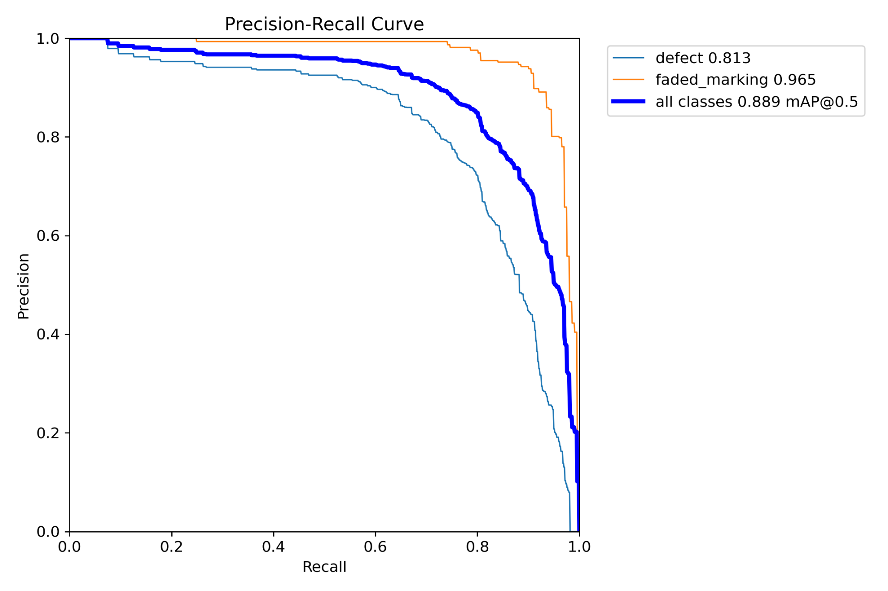

# Cycling Infrastructure Monitoring — YOLO11n + On-Device Impact Detection

**Master's Thesis Project (2026)**  
Faculty of Electrical Engineering, Mechanical Engineering and Naval Architecture (FESB), University of Split, Croatia  
In collaboration with Escuela Técnica Superior de Ingeniería (ETSI), University of Seville, Spain.

A mobile prototype that uses a smartphone mounted on a bicycle to detect surface defects and faded pavement markings, recognize physical impacts, and map the condition of cycling infrastructure.

The system combines **two on-device detection pipelines**:

- **Computer vision:** a fine-tuned **YOLO11n** model detects `defect` and `faded_marking` in live camera footage.
- **Motion sensing:** a **logistic regression** classifier detects `bump` events from smartphone accelerometer data.

Detected events are associated with GPS positions, spatially grouped, and displayed as a colour-coded route in the Flutter application.

## Results

### Visual detection — YOLO11n

| Metric | Result |
| --- | ---: |
| Custom dataset | **5,478 images**, **7,720 labelled instances** |
| Train / validation / test split | 4,287 / 751 / **440** original images |
| Overall **mAP@50** (held-out test set) | **0.889** |
| Overall **mAP@50–95** (held-out test set) | **0.708** |
| `defect` AP@50 | 0.813 |
| `faded_marking` AP@50 | 0.965 |
| iOS inference performance | **45–60 FPS** in the tested configuration |

The test set was collected separately and reserved for final evaluation; it was not used to tune or select the model.

The reported FPS is an observed development measurement on the tested iOS device, not a benchmark across devices. AP/mAP values are object-detection metrics, not percentages of correctly classified frames.

### Impact detection — accelerometer

| Metric | Result |
| --- | ---: |
| Method | Logistic regression on accelerometer features |
| Data collection | 60 bicycle rides; 450 manually labelled impact events |
| Precision / recall | 0.828 / 0.858 |
| **F1 score** | **0.843** |
| Evaluation | Leave-one-ride-out cross-validation; event-level matching |

## Demo — continuous on-device detection

**[Watch the full demonstration on YouTube](https://youtu.be/svyrwcqMdJ8)**

The recording shows continuous detection, including the accelerometer-based `bump` event later in the video. The application allows the detection-confidence threshold to be adjusted.

## Precision–recall curve

## Development workflow

1. Recorded bicycle-path footage with a smartphone mounted on a bicycle; extracted frames, selected examples, and annotated both detection classes.
2. Prepared the custom dataset in Roboflow and fine-tuned a pretrained YOLO11n model with Ultralytics on a Google Colab NVIDIA T4 GPU.
3. Evaluated the selected model on a separate 440-image test set.
4. Experimented with TensorFlow Lite / FP16 exports during Android prototyping, then exported the **final iOS model to Core ML with 16-bit weights and integrated NMS**.
5. Integrated live object detection in a **Flutter** application using a locally adapted Ultralytics YOLO plugin; implemented accelerometer-based impact classification and GPS-linked event mapping.
6. Tested route mapping over repeated rides and exported observations in JSON / GeoJSON formats.

## Technology

`Python` · `Ultralytics` · `YOLO11n` · `Google Colab` · `Roboflow` · `Flutter` · `Dart` · `Core ML` · `iOS` · `Accelerometer` · `Logistic Regression` · `GPS` · `GeoJSON`

## Repository scope

This repository is a **portfolio overview of the master's thesis**, including evaluation results and a demonstration.

The full annotated dataset, model weights, and application source code are not currently published here.

The system was built using established open-source libraries and existing mobile ML components.
